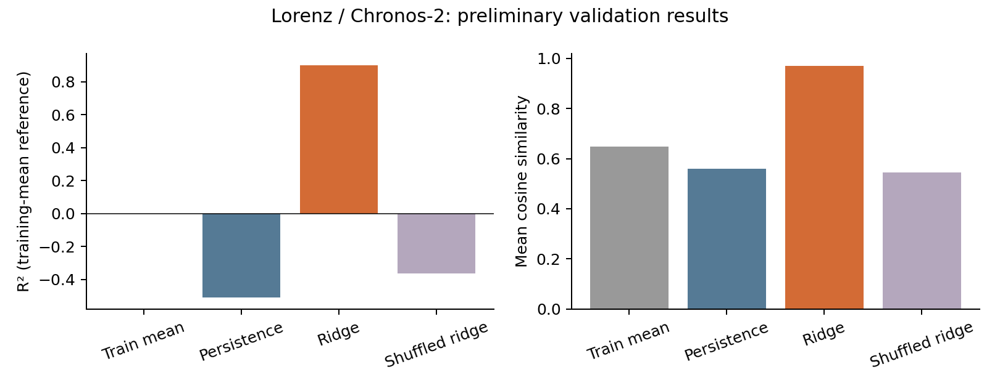
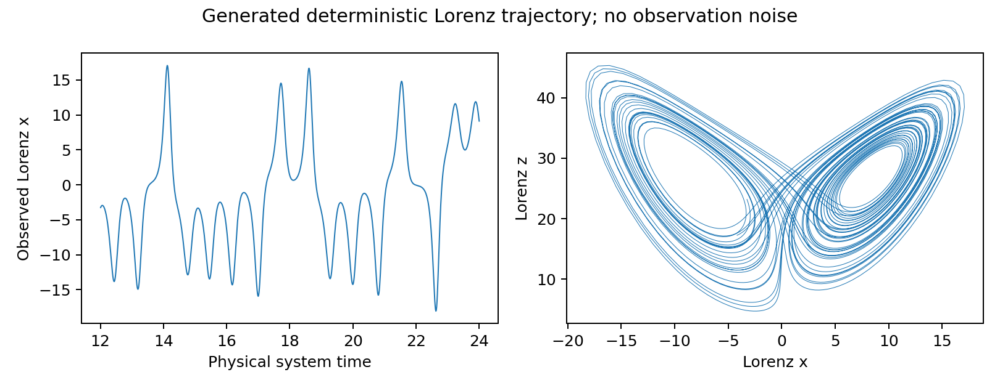

# Baseline results — 11 October 2026

Frozen Chronos-2; Lorenz coordinate `x`, no noise, seed 2026. The baseline uses
32768 observations, context 512, stride 16 and encoder block 5. It predicts the
state one patch ahead using 1401 train and 140 validation pairs; 345 test pairs
are reserved. Ridge alpha is 10, selected on validation.

| Baseline | Validation R² | Validation cosine |
| --- | ---: | ---: |
| Train mean | 0.000 | 0.648 |
| Persistence | -0.509 | 0.559 |
| Ridge | 0.901 | 0.971 |
| Shuffled-target ridge | -0.364 | 0.544 |

Ridge gains **1.410 R²** and **0.412 cosine** over persistence. R² uses the
training-target mean as its reference.

Measured pipeline time: **12.81 s** on one H200 with cached weights; setup and
process startup are excluded. All 12 tests and split audits passed. Two smoke
runs produced exactly equal data, states, manifests and metrics.

See the [conclusions](../../docs/conclusions.md) for interpretation and the
[next steps](../../docs/remaining_plan.md) for remaining experiments.

See [setup](../../README.md), [protocol](../../docs/experiment_protocol.md),
[scores and gains](baseline_summary.csv) and [run settings/timing](run_summary.json).

