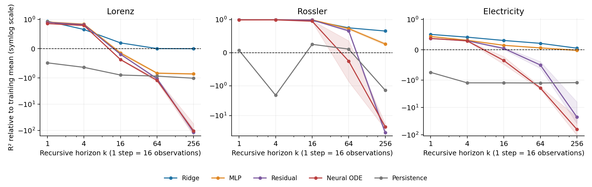
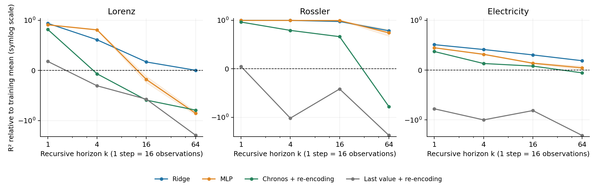

# Matched hidden-state transition comparison

Validation results, 26 October 2026.

Frozen Chronos-2 middle block 5 (sixth of 12); context 512; one analysis step advances 16 observations. Each dataset has eight training and four unseen validation series. All horizons and models use the same reporting starts. Every transition is applied recursively without true future states.

Ridge fits one-step pairs, with regularization selected by recursive four-step validation R². MLP, residual and ODE share a 768 → 256 → 768 Tanh network and a four-step training loss, with three initialization seeds. ODE uses RK4 with four substeps during training and rollout. The backbone is never fine-tuned.

## Main comparison

Macro R² uses each horizon's training-target mean as its reference. Zero equals that constant baseline; negative values are worse. Values after ± are sample standard deviations of the three seed-level macro scores, not confidence intervals.

### Lorenz

| Model | k=1 | k=4 | k=16 | k=64 | k=256 |
| --- | ---: | ---: | ---: | ---: | ---: |
| Training mean | 0.000 | 0.000 | 0.000 | 0.000 | 0.000 |
| Persistence | -0.484 | -0.638 | -0.901 | -0.939 | -1.026 |
| Ridge | 0.941 | 0.658 | 0.199 | 0.004 | 0.000 |
| MLP | 0.913 ± 0.008 | 0.840 ± 0.006 | -0.149 ± 0.052 | -0.836 ± 0.019 | -0.864 ± 0.023 |
| Residual | 0.901 ± 0.002 | 0.822 ± 0.005 | -0.192 ± 0.013 | -1.068 ± 0.069 | -115.732 ± 24.623 |
| Neural ODE | 0.859 ± 0.009 | 0.794 ± 0.005 | -0.372 ± 0.018 | -1.241 ± 0.175 | -103.849 ± 48.168 |

### Rossler

| Model | k=1 | k=4 | k=16 | k=64 | k=256 |
| --- | ---: | ---: | ---: | ---: | ---: |
| Training mean | 0.000 | 0.000 | 0.000 | 0.000 | 0.000 |
| Persistence | 0.074 | -2.075 | 0.253 | 0.108 | -1.421 |
| Ridge | 0.999 | 0.997 | 0.972 | 0.751 | 0.655 |
| MLP | 0.997 ± 0.000 | 0.996 ± 0.000 | 0.994 ± 0.001 | 0.727 ± 0.032 | 0.262 ± 0.042 |
| Residual | 0.996 ± 0.000 | 0.996 ± 0.000 | 0.987 ± 0.001 | 0.661 ± 0.032 | -37.698 ± 8.070 |
| Neural ODE | 0.990 ± 0.000 | 0.992 ± 0.000 | 0.953 ± 0.016 | -0.255 ± 0.615 | -23.815 ± 4.710 |

### Electricity

| Model | k=1 | k=4 | k=16 | k=64 | k=256 |
| --- | ---: | ---: | ---: | ---: | ---: |
| Training mean | 0.000 | 0.000 | 0.000 | 0.000 | 0.000 |
| Persistence | -0.742 | -1.250 | -1.254 | -1.264 | -1.232 |
| Ridge | 0.509 | 0.418 | 0.309 | 0.215 | 0.055 |
| MLP | 0.441 ± 0.006 | 0.316 ± 0.002 | 0.150 ± 0.007 | 0.064 ± 0.013 | -0.014 ± 0.029 |
| Residual | 0.373 ± 0.005 | 0.299 ± 0.003 | 0.047 ± 0.041 | -0.499 ± 0.112 | -22.349 ± 16.092 |
| Neural ODE | 0.377 ± 0.004 | 0.295 ± 0.005 | -0.351 ± 0.129 | -1.933 ± 0.201 | -63.485 ± 40.650 |

Figure 1. Mean R² versus recursive horizon, evaluated on identical starts within each dataset. Shading shows ± one seed standard deviation for neural models. The vertical axis uses a symmetric logarithmic scale to show strongly negative long-horizon scores; numeric values are in the tables. The dashed line is the training-mean baseline.

## Forecast the input, then encode it

This separate comparison uses 32 fixed starts per validation series, a subset of the main report manifest. All methods below are rescored on exactly those starts. Chronos predicts the median continuation from the past window; the predicted rolling window is then re-encoded. Last-value continuation is a simpler input baseline. It is not valid to compare this subset directly with the full-grid table above.

### Lorenz

| Model | k=1 | k=4 | k=16 | k=64 |
| --- | ---: | ---: | ---: | ---: |
| Ridge | 0.940 | 0.612 | 0.169 | 0.003 |
| MLP | 0.911 | 0.810 | -0.180 | -0.855 |
| Residual | 0.897 | 0.777 | -0.187 | -1.052 |
| Neural ODE | 0.858 | 0.779 | -0.357 | -1.248 |
| Chronos + re-encoding | 0.818 | -0.067 | -0.592 | -0.792 |
| Last value + re-encoding | 0.180 | -0.306 | -0.574 | -2.118 |

### Rossler

| Model | k=1 | k=4 | k=16 | k=64 |
| --- | ---: | ---: | ---: | ---: |
| Ridge | 0.999 | 0.997 | 0.975 | 0.783 |
| MLP | 0.997 | 0.997 | 0.994 | 0.741 |
| Residual | 0.996 | 0.996 | 0.988 | 0.675 |
| Neural ODE | 0.990 | 0.992 | 0.952 | -0.275 |
| Chronos + re-encoding | 0.963 | 0.791 | 0.662 | -0.779 |
| Last value + re-encoding | 0.047 | -1.048 | -0.417 | -2.595 |

### Electricity

| Model | k=1 | k=4 | k=16 | k=64 |
| --- | ---: | ---: | ---: | ---: |
| Ridge | 0.511 | 0.414 | 0.306 | 0.189 |
| MLP | 0.449 | 0.318 | 0.139 | 0.046 |
| Residual | 0.381 | 0.294 | 0.009 | -0.531 |
| Neural ODE | 0.388 | 0.279 | -0.350 | -1.808 |
| Chronos + re-encoding | 0.374 | 0.133 | 0.081 | -0.055 |
| Last value + re-encoding | -0.777 | -0.999 | -0.812 | -2.217 |

### White-noise specificity check

| Model | k=1 | k=4 | k=16 | k=64 |
| --- | ---: | ---: | ---: | ---: |
| Ridge | 0.050 | 0.081 | 0.017 | 0.000 |
| Chronos + re-encoding | -3.030 | -1.955 | -1.533 | -1.998 |
| Last value + re-encoding | -2.619 | -1.828 | -1.478 | -3.433 |

A gain over input re-encoding also occurs on white noise. It therefore cannot establish extra predictive information, a meaningful autonomous law, or the original H2 by itself.

Figure 2. R² on the matched re-encoding subset. The curves compare recursive hidden-state readouts with two input-continuation baselines. These are different prediction objectives and do not establish a causal explanation for readout gains.

## How to read the supporting files

- `core_summary.csv`: full-grid scores, seed variation and 95% percentile intervals resampling validation series after averaging seeds within each series.
- `paired_summary.csv` and `paired_gain_over_reencoding.csv`: matched-subset scores and paired readout-minus-Chronos-re-encoding differences, with series-level intervals.
- `core_entities.csv` and `paired_entities.csv`: separate results for every validation series and seed.
- `encoder_controls.csv`: re-encoding scores in pretrained and three randomly initialized encoder spaces. Each condition is evaluated against its own target; cross-encoder R² differences do not identify a pretraining effect.
- `variance_concentration.csv`: training variance in the largest 1, 5 and 20 coordinates or principal components; `core_summary.csv` also reports coordinate-standardized and whitened PCA95 R².
- `path_statistics.csv`: 256-step finite-rollout diagnostics on the same 16 starts per series. Sliced Wasserstein distance uses the last 128 states in eight whitened training PCs; ACF error uses lags 1, 4, 16 and 64, and PSD error uses the first two PCs. Smaller distances/errors are better.
- `bounded_fraction` requires every predicted state to stay within ten times the training 99th-percentile centered radius. It is a coarse explosion check, not a physical stability theorem. Constant paths can pass it.
- `ode_resolution.csv`: eight-versus-sixteen-substep prediction differences at k=4, on the original selection anchors; these scores must not be mixed with the long report manifest.
- `oracle_precision.csv`: encoding true future windows agrees with cached FP16 states within the stated 0.2% relative-L2 tolerance. This is an implementation check, not a forecast.
- `input_latent_error.csv`: descriptive raw-window/latent-error correlations across overlapping anchors, without significance claims.

## Interpretation limits

There are only four independent validation series per main dataset and two for white noise. Bootstrap intervals are conditional on this small set; seeds and overlapping windows are not independent new series. The same validation entities are used for model selection and reporting, so these are development results, not unbiased final-test estimates. For synthetic systems, unseen series change initial conditions at fixed parameters. The finite trajectory statistics do not prove recovery of an invariant measure or a chaotic attractor. The original H1/H2 are unchanged and no final test is evaluated.

The ODE implementation control passes on a known stable oscillator (four-step R² above 0.999). This verifies one implementation/training case and does not establish ODE suitability for the hidden states.

Reproduction: run `scripts/build_consistent_report.py --run-dir <saved-run> --output-dir <report-directory>` after the grid, input re-encoding and white-noise control complete. Raw features, checkpoints and logs remain outside the repository.

The complete rerun reproduces all 27 neural weight sets and all entity metric files exactly. The audit checks 126 comparisons, including re-encoding controls. This is a reproducibility check on the same validation data, not a new independent test.

`ode_long_resolution.csv` and `ode_long_resolution_entities.csv` report frozen-field 4/8/16-substep checks on the common 16-start-per-entity path subset. The negative 256-step ODE result persists at finer resolutions.
