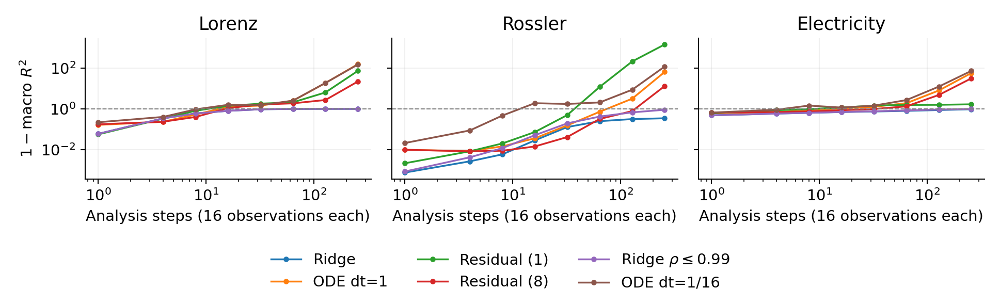

# Review snapshot — 17 October 2026

These are validation results from frozen Chronos-2. Test data remain closed.
Primary datasets have four unseen validation entities each; the extension has eight.
Neural scores average three seeds within each entity, then weight entities equally.

## Short forecasts

R² predicts the next hidden state, rather than the next raw observation.
One analysis step advances by 16 observations.

| Dataset | Ridge, 1 step | MLP, 1 step | Ridge, 4 steps | MLP, 4 steps |
| --- | ---: | ---: | ---: | ---: |
| Lorenz | 0.940 | 0.960 | 0.685 | 0.806 |
| Rossler | 0.999 | 0.998 | 0.998 | 0.998 |
| Electricity | 0.519 | 0.475 | 0.413 | 0.390 |
| Thomas | 0.781 | 0.852 | 0.496 | 0.528 |
| Aizawa | 0.999 | 0.998 | 0.999 | 0.998 |
| Solar | 0.804 | 0.799 | 0.729 | 0.736 |
| Additional electricity meters | 0.542 | 0.511 | 0.433 | 0.415 |

The primary comparison uses identical anchors supporting eight past states and
64 future steps. This slightly changes the earlier Lorenz MLP result of 0.804.
History readouts use the current and previous states; VAR(8) uses all eight.
Adding history helps some linear fits; adding the current observed patch has a
small effect in the tested setup. Neither observation establishes a Markov state.

## What limits the interpretation

- Hidden states are not consistently smoother than observed patches. The result
  depends on the dataset and coordinate scaling.
- Random-weight states are also predictable. Adjacent contexts share 496 of 512
  observations; context length, layer and recurrence affect the scores.
- The selected temporal MLP beats the depth control numerically, but the same
  threshold passes on white noise and with a constant predictor. The planned
  comparison alone cannot establish meaningful temporal dynamics.
- At 256 steps, ridge retains 0.655 R² on Rossler, about zero on Lorenz and 0.041
  on electricity. The tested nonlinear recursive models become substantially worse.
- The ODE is sensitive to integration resolution. It fits short coarse-grid
  transitions better than the corresponding finely integrated field. Solver
  refinement is reported explicitly; a general continuous law is unsupported.
- Frozen cross-dataset maps transfer unevenly. Different layers, contexts and
  random initializations also have different hidden targets, so their scores do
  not compare raw-series forecast accuracy.

In this plot, the dashed line is the training-mean baseline. Residual (1)/(8)
denotes the training segment length; ODE dt is the integration step in analysis
units; rho is the linear operator's spectral radius. Macro R² weights entities equally.

- [Context/layer sensitivity](controls.png): one-step ridge R²; context is measured
  in observations, blocks are zero-indexed, and Final norm is the final normalized output.
- [Fixed-start PCA trajectories](horizons.png): PC1/PC2 are training-fitted principal
  components. Observed means extracted hidden states, not raw observations. Dots
  mark initial states; top panels cover 0–4 steps and bottom panels 0–256.
- [Frozen transfer](transfer.png): columns identify the source of the fitted ridge
  map, rows the unseen target dataset. Cell values are one-step R²; colors show
  1−R² on a logarithmic scale. Extra meters are additional electricity meters.

The [rounded table](summary.csv) includes both protocols, seed variability,
bootstrap intervals, ODE solver refinement and descriptive controls.

## Reproduction and scope

The [review protocol](../../docs/review_protocol.md) gives settings and commands.
The audit checks the original feature cache, extension features, shared anchors,
temporal boundaries and untouched reserved identities. The code has 29 passing tests.
Precise metrics, manifests, fitted models and logs remain outside Git.

This snapshot contains one pretrained checkpoint, with layer robustness checks.
Final test scoring and a second pretrained architecture are not included.
The paper is stored separately from the code for author review.
