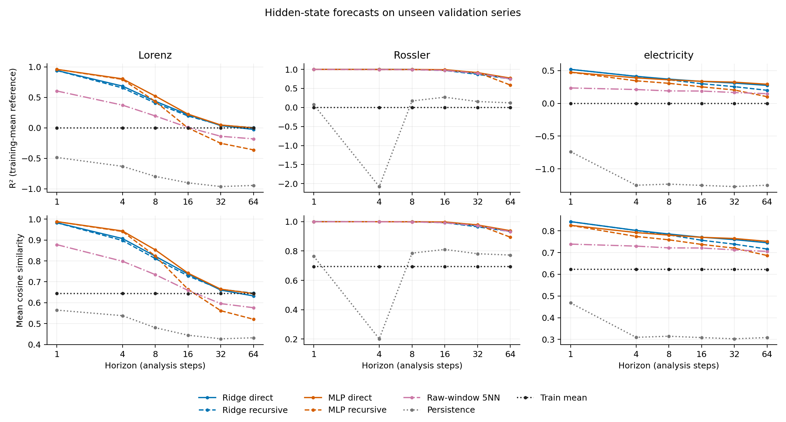
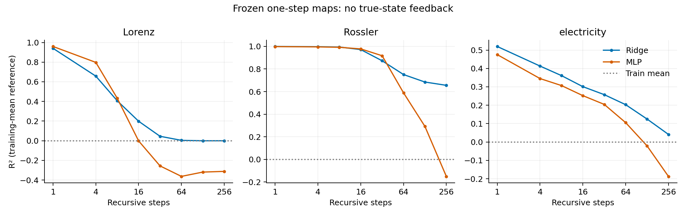
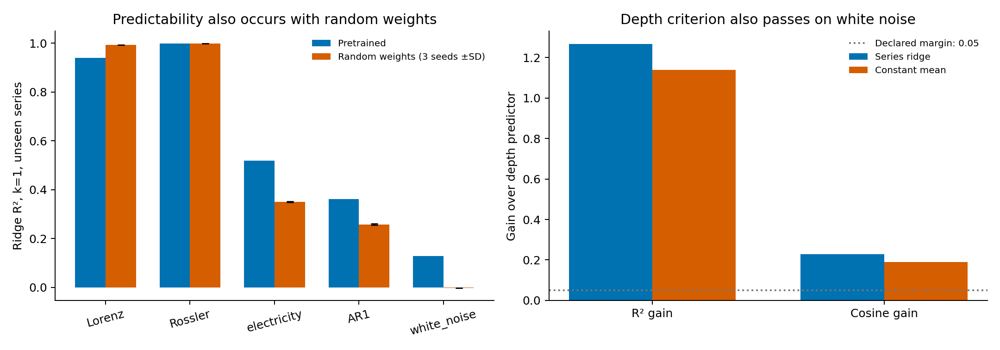
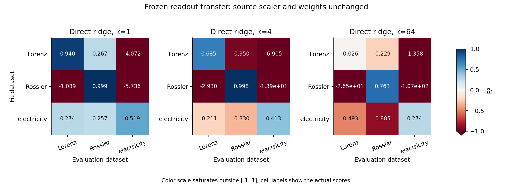

# Multi-series results — 17 October 2026

46 development series: Lorenz, Rossler, electricity, AR(1) and white noise.
Compared chronological and whole-series holdouts, horizons 1–64, three random
initializations, three MLP seeds, history inputs, depth maps and raw-window analogs.
Frozen one-step models were also rolled forward for 128/256 steps.
One analysis step advances a 512-sample context by 16 observations; adjacent
contexts share 496 samples. These scores concern hidden states, not raw forecasts.

## R² on unseen validation series

| Dataset | Ridge, k=1 | MLP, k=1 | Ridge, k=4 | MLP, k=4 |
| --- | ---: | ---: | ---: | ---: |
| Lorenz | 0.940 | 0.959 | 0.685 | 0.804 |
| Rossler | 0.999 | 0.998 | 0.998 | 0.998 |
| electricity | 0.519 | 0.475 | 0.413 | 0.389 |

Scores average over four held-out series; MLP also averages three seeds.
R² uses the training-target mean. The CSV includes cosine, paired bootstrap
intervals over series and both split protocols. Validation selects alpha/epochs;
these are exploratory results. Final test data remain reserved.

## Frozen models after 256 recursive steps

| Dataset | Ridge R² | MLP R² |
| --- | ---: | ---: |
| Lorenz | 0.000 | -0.312 |
| Rossler | 0.655 | -0.150 |
| electricity | 0.041 | -0.187 |

Each prediction is fed into the next step. These runs use common k=256 anchors,
so their shorter-horizon scores are separate from the main k=64 comparison.

## Findings

- MLP improves Lorenz at four steps, but does not consistently improve electricity.
- Random weights also produce highly predictable states: Lorenz one-step ridge
  reaches about 0.993 R². High predictability alone does not establish a pretraining effect.
- Rossler has many similar raw windows; 5-neighbor analog forecasts are already
  strong. The fixed 0.999 cosine filter retains about 6% of unseen-series pairs;
  ridge still performs well on that subset. No parameters are retuned after filtering.
- Frozen readouts transfer unevenly: Lorenz → electricity gives R² = -4.072,
  while a readout trained on electricity gives 0.519. One shared operator is unsupported.
- The declared series-versus-depth threshold also passes on white noise, even
  for a constant-mean predictor. It is insufficient evidence for distinctive temporal dynamics.
- Full H1/H2 and autonomous dynamics remain unresolved. Short-step prediction,
  long rollouts and pretraining effects must be reported separately.

## Figures and records

[Rounded scores](summary.csv) · [Run scope and timing](run_summary.json) ·
[Protocol and reproduction](../../docs/study_protocol.md).

20 tests and the artifact audit passed. The GPU ridge solver agrees with an
independent scikit-learn SVD fit. Ten fixed FP32/FP16 sensitivity cases changed
R² by less than 0.001. Precise scores, states, fits and logs stay outside Git.
